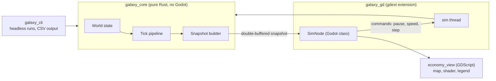

# Rust port: design

Status: **built** (`rust/`): goods crate, economy, colonization, relations, war, diplomacy, personality, threat, alliances, treaties, CLI, and the Godot extension (`GalaxySim`, used by `economy_proto/rust_view.tscn`). Rust is now the source of truth for star and planet generation, including the planet classifier and image-driven placement. Not yet: multi-core parallelism, war-gaming. This document is updated whenever a feature lands in the GDScript prototype
(`economy_proto/`), so the port's shape keeps up with the rules. See the changelog at the end.

## 1. Why, and when

GDScript is the bottleneck. On the 46-system, 4-empire map, one month costs 15 ms at year 10 and ~300 ms by year 180
(438 colonies). Cost grows faster than colony count. 10 empires x 1,000 systems would be several seconds a month.

| Run | Colonies | ms / month |
|---|---|---|
| 46 systems, 4 empires, year 10 | 40 | 16 |
| 46 systems, 4 empires, year 60 | 230 | 77 |
| 46 systems, 4 empires, year 180 | 438 | 300-380 |

Where the time goes (46 systems, 4 empires, 180 years, 413 s total):

| Phase | Share |
|---|---|
| Freight corporations | 56% |
| Extractor corporations (review/expand) | 21% |
| Producer corporations | 15% |
| Markets, emergence, migration, surveys | ~7% |
| Relations, war, diplomacy, personality, threat | < 1% |

**Expected gain:** 20-50x from compiled code, flat data and no dictionary lookups; more from running the read-only
scoring phases on several cores (section 6).

**Gate for starting the port:** the diplomacy roadmap reaches step 5 (multi-party war), so the data model includes
coalitions. Rules changed after the port starts must be written twice, so the port waits until churn slows.

## 2. Goals and non-goals

Goals:
- Same rules and outputs as the GDScript sim, checked by parity tests (section 9).
- Godot stays the front end: map, territory shader, UI.
- A headless CLI that prints the same CSV/EMP/REL/EVENT lines as `run_headless_csv.gd`, so existing plot scripts work.
- Deterministic for a given seed, single- or multi-threaded.

Non-goals for the first version: new mechanics, save/load, networking, mod support.

## 3. Architecture



Cargo workspace:

| Crate | Role | Depends on |
|---|---|---|
| `galaxy_core` | all rules, world state, tick, metrics rows | `rand_pcg`, `rayon` (optional feature), `indexmap` |
| `galaxy_cli` | headless runner; same arguments and output as `run_headless_csv.gd` | `galaxy_core` |
| `galaxy_gd` | Godot 4.7 extension via `godot` (gdext); exposes `SimNode`, owns the sim thread | `galaxy_core`, `godot` |
| `parity` (tests) | runs GDScript and Rust on the same seeds, compares outputs | `galaxy_cli` |

`galaxy_core` never sees Godot types. `Vector2` becomes `glam::DVec2` or a local `[f64; 2]`.

## 4. Data model

Arenas plus typed indices instead of object references. Everything is `f64` like GDScript.

```rust
pub struct ColonyId(u32); pub struct CorpId(u32); pub struct EmpireId(u8); pub struct SystemId(u32);

pub const GOODS: usize = 5;               // Ore, Metal, Parts, Food, Water (goods.gd)
pub type PerGood = [f64; GOODS];          // replaces the Goods.ID -> float dictionaries

pub struct World {
    pub tick: u32,
    pub systems: Vec<StarSystem>,         // system_node.gd
    pub colonies: Vec<Colony>,            // colony_market.gd: settled markets AND frontier bodies
    pub corps: Vec<Corp>,                 // corporation.gd (dead corps removed between ticks; ids never reused)
    pub empires: Vec<Empire>,             // empire.gd
    pub relations: PairMatrix<Relation>,  // upper triangle, N*(N-1)/2 entries (economy_sim._rel)
    pub wars: Vec<War>,                   // military.gd; War { a, b, start, peaks, parent: Option<WarId> }
    pub events: Vec<Event>,
    pub rng: SimRng,                      // section 7
    pub caches: Caches,                   // boards, route geometry, memos (rebuildable, never saved)
}
```

| GDScript | Rust | Notes |
|---|---|---|
| `ColonyMarket` | `Colony` | `stock`, `price`, `use`, `capacity`, `extraction` become `PerGood`; `intel` becomes `[Intel; MAX_EMPIRES]` |
| `ColonyMarket.requests` | `Vec<Request>` cleared each tick | |
| `Corporation` + `Facility` | `Corp { kind: CorpKind, facilities: Vec<Facility>, .. }` | `CorpKind` enum carries kind-specific state (freight fleet, survey jobs) |
| `Empire` | `Empire` | `known: Dictionary` becomes a `BitVec` over systems; `threat` becomes `[f64; MAX_EMPIRES]` |
| `SystemNode` | `StarSystem { owner: Option<EmpireId>, occupier: Option<EmpireId>, bodies: Vec<ColonyId> }` | |
| `economy_sim.relations` (string keys) | `PairMatrix<Relation>` | `stance` becomes an enum |
| `Personality` traits dictionary | `Traits([f64; 7])` + `base: Traits` | trait order fixed (section 10) |
| `events: [[tick, text]]` | `Event { tick, kind: EventKind, a, b, .. }` | text formatted only on output, so the format matches the GDScript lines |

`MAX_EMPIRES = 8`, matching the territory shader's palette.

## 4a. Galaxy placement from images

William's placement design (from the original `universe.gd`):

- **Density map (greyscale image):** each pixel's brightness is the chance a star can sit there. Brighter core and arms
  get more stars; dark lanes and the void get none.
- **Population map (colour image):** at a star's pixel, the R, G and B channels are tried in descending order
  (random order on ties) and the first that passes a roll against its own value picks the population:
  G = Pop I (spiral-arm ridges, youngest), B = Pop I-i (arms), R = Pop II-i, none = Pop II.
- The population then drives metallicity, age, star class and everything downstream in the planet pipeline.

Port notes: the CLI loads the two PNGs with the `image` crate; the extension receives them as Godot `Image` byte buffers.
Sample positions by weighted draw over a cumulative brightness array (exact star count, one pass) rather than one
roll per pixel then a shuffle. The two images must have the same size.

## 5. Module map

| GDScript file | Rust module | Contents |
|---|---|---|
| `goods.gd` | `core::goods` | good ids, base prices, recipes |
| `colony_market.gd` | `core::market` | prices from cover, consumption, births/deaths, maintenance, migration hooks |
| `corporation.gd` | `core::corp::{extractor, producer, freight, surveyor, boards}` | operate, review and expand, construction, freight routing, surveys and claims; opportunity, outpost and survey boards |
| `economy_sim.gd` | `core::world`, `core::colonize`, `core::relations`, `core::metrics` | tick order, taxes, emergence, colonization (outposts, state colonies, sectors), relations and borders, routes and tariffs, CSV rows |
| `galaxy_colonies.gd`, `system_node.gd` | `core::galaxy` | systems and bodies for the economy |
| `galaxy.gd`, `solar_system.gd`, `planet.gd`, `planet_resources.gd`, `astronomy_data.gd` | `core::astro` | the real star and planet generator (population, class, orbits, axes, classification, resources); image-driven placement (section 4a) |
| `military.gd` | `core::military` | target strength, upkeep, fronts, attrition, occupation, peace |
| `diplomacy.gd` | `core::diplomacy::{facts, actions, goals, planner}` | GOAP: facts, actions, goals, planner search, execution |
| `personality.gd` | `core::personality` | traits, weights, drift, event shifts, regime change |
| `threat.gd` | `core::threat` | threat scores, main threat, common threats |
| `treaties.gd` | `core::treaties` | war goals, ultimatums, war score, negotiation, terms, revanchism |
| `alliances.gd` | `core::alliances` | pacts, guarantees, call to arms, effective strength, lapsing |
| (planned) | `core::wargame` | Monte Carlo rollouts of the abstract war model to price war, peace and alliance decisions; runs on beliefs (noisy, personality-biased estimates), own RNG stream per rollout seeded from (tick, empire, candidate), rollouts in parallel with `rayon` |
| `run_headless_csv.gd` | `galaxy_cli` | argument parsing, output |
| `economy_view.gd` | stays GDScript | reads `SimNode.snapshot()` instead of live objects |

## 6. Tick pipeline

The order below is the GDScript `_tick` order and must not change. **R** = reads, **W** = writes.

1. Reset per-month caches and port counters. W: caches, `Colony.port_used`.
2. Corporations, in rotating fair turn order (`_turn_order`). Each corp: operate facilities, review and expand,
   freight, surveys; then pay tax to its empire. R/W: colony stocks, prices, corp cash, empire treasury.
   **Sequential by design:** each corp sees the stocks the previous one left.
3. Migration and sector discoveries, per empire.
4. Multi-empire only: relations, fronts, military (monthly), occupation effects; in month 6 of each year:
   threat, personality drift, GOAP turn per empire.
5. State colonization and survey orders (every `STATE_REVIEW_MONTHS`).
6. Markets tick (prices, births, consumption) and corporation emergence, per colony in order.
7. Remove dead corporations.

### Where parallelism is safe

Corporations must stay sequential in step 2, but most of their cost is **scoring**, which only reads the world:

| Work | Pattern |
|---|---|
| Opportunity / outpost / survey boards (built once per month, per good or per empire) | build boards in parallel at the start of step 2 (read-only), then corps consume them sequentially |
| Freight lane scoring: each freight corp scans source x destination pairs | score candidates in parallel against a frozen view; commit the chosen loads sequentially and re-validate stock at commit. **Parity risk:** the GDScript version re-reads live stock while scoring. Either keep scoring sequential for parity, or accept a rule change ("corps plan on start-of-month prices") and re-baseline. Recommendation: ship v1 sequential and exact, then make the change once as a deliberate rule change. |
| Route geometry (per system pair) | precomputed once per ownership change, parallel |
| Market tick (step 6) | each colony is independent except emergence, so the market updates run in parallel and emergence runs after, in colony order |
| Threat scores, relation borders | parallel per pair |

All parallel steps write to per-item slots and are reduced in fixed index order, so results do not depend on the number
of threads.

## 7. Determinism

- **One RNG stream per subsystem** (`sim`, `personality`, `galaxy`), each a PCG32 seeded from the run seed.
  `Personality` already uses its own stream in GDScript for exactly this reason.
- **Matching Godot's RNG:** Godot's global `randf()` and `RandomNumberGenerator` are PCG32 with Godot's own seeding and
  float conversion. Port that exactly (it is ~40 lines in `core/math/random_pcg.*`) so a Rust run can replay the
  GDScript random sequence. Every `randf`/`randi`/`randfn` call site must be ported in the same order (25 call sites today).
- **Sorting:** Godot's `sort_custom` is unstable; Rust's `sort_by` is stable. Every GDScript sort with possible ties
  needs an explicit tie-break (already done for the payback sorts). **Pre-port task:** audit every `sort_custom` and add
  tie-breaks in GDScript first, re-baseline, then port.
- **Iteration order:** GDScript dictionaries iterate in insertion order. Use `Vec`/`IndexMap`, never `HashMap`, wherever
  order affects results.
- **Floats:** keep `f64`; avoid fused multiply-add and reassociation (no `-ffast-math` equivalents). `ln`, `powf` and
  `exp` may differ from Godot's in the last bit; parity tests compare with a tolerance (section 9).

## 8. Godot boundary (`galaxy_gd`)

- `SimNode` (a Godot `Node`) owns a `galaxy_core::World` on a dedicated thread. The GDScript prototype already does this
  (sim on its own thread, map redrawn between months), so the view's behaviour carries over.
- **Commands in:** a channel of `Pause`, `Resume`, `SetSpeed(f64)`, `Step(n)`, `Configure{..}`.
- **Snapshot out:** after each month the thread fills a `Snapshot` and swaps it into a double buffer. The view reads
  the latest snapshot and never touches live state, so there is no lock on the hot path.

```rust
pub struct Snapshot {
    pub tick: u32,
    pub systems: Vec<SysView>,        // position, owner, occupier, at_front, label, colony/body counts
    pub colonies: Vec<ColonyView>,    // position, pop, shortage, owner
    pub empires: Vec<EmpireView>,     // name, colour, colonies, systems, pop, treasury, strength, traits label, wars
    pub shipments: Vec<Shipment>,     // this month's deliveries, for the ship layer (replaces the shipment_made signal)
    pub wars: Vec<(u8, u8)>,
    pub events: Vec<String>,          // new since the last snapshot
}
```

- Exposed to GDScript as `PackedFloat32Array`s plus small dictionaries for labels, so the view stays thin. The territory
  shader keeps its 1-row float texture input, built straight from `systems`.

## 9. Parity testing

1. `galaxy_cli` prints the same line formats as `run_headless_csv.gd`: `CSV`, `EMP`, `REL`, `EVENT`, `TIME`, `PROFILE`.
2. The parity harness runs both implementations on a fixed matrix of seeds and setups:
   1 empire x 100 systems; 4 empires x 46 systems (the view's map); 4 empires x 200 systems.
3. Compare `CSV`/`EMP`/`REL` columns with a relative tolerance (1e-9 to start); `EVENT` lines must match exactly.
   The first divergent tick and column are reported.
4. Port module by module behind the harness, in this order: goods and markets, extractors and producers, freight,
   colonization and surveys, relations and routes, military, diplomacy, personality, threat.
   Until a module is ported, its outputs can't be compared, so each step is verified on the setups that exercise it.
5. After v1 is exact, deliberate rule changes (for example parallel freight scoring) re-baseline both sides together.

## 10. Feature register

Each feature in the prototype, with what the port must carry. New rows are added as features land.

| Feature | GDScript | State the port must carry |
|---|---|---|
| Markets, prices from cover, births and deaths | `colony_market.gd` | per-good stock/price/use/capacity, pop, max_pop |
| Extractors, producers, construction projects | `corporation.gd` | facilities with build progress, materials owed |
| Freight: ship classes, sailing-time budget, port congestion | `corporation.gd` | fleet size, class, memos (cache only) |
| Colonization: capital, frontier, surveys, claims, outposts, state colonies, sectors | `economy_sim.gd`, `corporation.gd` | per-empire intel per body, known systems, survey jobs |
| Taxes and treasury | `economy_sim.gd` | profit and wealth tax, empire treasury |
| Multi-empire relations, closed borders, treaties, tariffs | `economy_sim.gd` | relation matrix, territory, route geometry cache |
| GOAP diplomacy | `diplomacy.gd` | facts, actions and goals are rebuilt yearly; persistent: refusal cooldowns, arming_until, truces |
| War: strength, fronts, occupation, exhaustion, peace | `military.gd` | strength, exhaustion, wars (start, peaks), occupier per system, truce per pair |
| Army budget: target strength from smoothed income | `military.gd` | `avg_tax`, `target_strength` |
| Personality: 7 traits, drift, regime change | `personality.gd` | `traits`, `base_traits`, `stability`, `regime_year`; trait order: aggression, expansion, mercantile, xenophobia, militarism, caution, intervention |
| Trust and reputation | `alliances.gd` | `Relation.trust` as two directed values; `Empire.reputation` |
| Pacts and guarantees | `alliances.gd` | `Relation.pact`, `pact_year`; `Empire.guarantees` (id -> against, start year); `War.parent` (the war an ally joined) |
| Treaties and revanchism | `treaties.gd` | `War.goals`, `first_strike_until`; per pair: `reparations`, `forced_market`, `forced_transit`, `truce_until`; per empire: `revanche` (victor -> level, claims, since), `demilitarized_until/by` |
| Threat assessment | `threat.gd` | `threat[]` per empire, `main_threat`, `wars_started` (years), `systems_taken`, `sys_history` (yearly) |

## 11. Changelog

- 2026-11-26: multi-party wars. `War` has two sides (`sides: [Vec<EmpireId>; 2]`, leader first) instead of child wars:
  combat sums each side's committed strength (members without a front send half), losses are shared in proportion,
  any member may occupy any enemy member's front system. Allies answering calls to arms, coalition members (an
  aggressor they fear is winning) and opportunists (a winning attacker next door) join a side (`join_war`). Leaders
  negotiate peace for the whole war; each occupied system goes to its occupier; grudges are per (loser, gainer).
  Minor members can leave by separate peace; a collapsing leader capitulates for its side. Only goals about ending a
  war may plan `sue_for_peace`.

- 2026-11-26: guaranteed homeworlds (`World::capital_star`, `capital_spots`): in colonization runs each empire's
  capital star is generated first (a temperate rocky world with Ore >= 3 and Water or Food >= 3, star past the
  protoplanet age), placed on a ring (uniform galaxy) or spread across the density map (image galaxy). They count
  toward the system total.

- 2026-11-26: planet classifier (`astro::classify`) and image-driven placement (`astro::PlacementMaps`) ported; the CLI
  loads PNGs (`maps=default` or `maps=<dir>`), the extension loads them through Godot's Image (`density_map`,
  `population_map` keys). CI (`.github/workflows/rust.yml`) builds Linux and Windows and uploads `galaxy_gd.dll`.

- 2026-11-25: `galaxy_gd` built (godot-rust 0.5.6, `api-4-7`). `GalaxySim` runs the World on a Rust thread and keeps
  the newest `Snapshot` (plain data, `galaxy_core::snapshot`); `poll()` turns it into a Dictionary of packed arrays
  only when a new month is ready. `World` uses `Arc` instead of `Rc` so it can live on that thread.

- 2026-11-25: Rust-only rule fixes found by 500-year runs (not back-ported to GDScript): trade drift is one small
  nudge a year (not one per partner); incident drift 0.02; a regime change jumps from the old regime's values instead
  of locking in the drifted traits. Together these stopped every empire converging to the same personality.
  Performance: per-phase profiling (`PROFILE` lines), planner restricted to the goal's partner, incremental survey
  board, claim counter, monthly opportunity boards re-checked at pick time, per-empire known-bodies list, incremental
  nearest-colony cache, monthly freight lane lists. 1000 systems x 8 empires x 500 years: 324 s -> 111 s.

- 2026-11-25: **built.** `galaxy_goods` crate added at William's request: every goods table (goods, raw costs, recipes,
  population consumption, maintenance, salvage, subsistence, construction materials, military unit and upkeep goods)
  in one crate, read by the sim. Parity testing against GDScript was dropped by decision; behaviour was checked by
  comparing run shapes. Speed: 46 systems x 4 empires x 180 years in 3.8 s (GDScript ~300-500 s).
  Two GDScript slips were ported as intended rather than as written: the thermal lifespan uses a real cube root
  (GDScript's `1/3` is integer 0), and moon counts check the planet type.

- 2026-11-25: added `core::treaties`. Terms are a tagged enum (`Cede(SystemId) | Reparations | OpenMarket | Transit |
  Demilitarize | Humiliate`), valued by one pure function so negotiation and war-gaming share it.
- 2026-11-25: planned `core::wargame` (after multi-party wars). Keep the war model a pure function of a small
  `WarState` so rollouts can clone it cheaply.
- 2026-11-25: added pacts and guarantees (`core::alliances`). Wars gain a `parent` link: an ally's war joins the
  original one, fights on its front when it has none of its own, and ends with it. Store wars in a slot map so the
  link survives removals.
- 2026-11-25: added image-driven galaxy placement (section 4a) and the astro modules to the module map.
- 2026-11-25: document created. Covers the prototype up to war, personalities, army target strength and threat
  assessment.

### Diplomatic plays (`plays.rs`)
A demand with a 12-month deadline. Third parties back a side: pact partners, guarantors, and empires that fear the demander. At month 6 the crisis escalates: both sides arm, more backers are asked, and a neutral interventionist may mediate a compromise (the cheapest demand only). The target concedes when outmatched past its "spine". The demander may back down only after escalation, at a threshold scaled by its aggression; backing down costs reputation and brings a 10-year truce. At the deadline the crisis becomes war, with the backers joining. `go_to_war` picks a route by personality: a first strike for aggressive and reckless empires, a play for cautious or mercantile ones, an ultimatum otherwise.

### Roadmap: data-driven personalities
Goal: add or change a trait or an archetype without touching sim code.
- Traits are defined in a data file (`personalities.ron`/`.toml`). Each trait has a name, a default range, a drift rate, a reversion rate, and a regime-change weight. The `TRAIT_*` constants (about 60 uses) become lookups by trait id, resolved once at load time.
- Archetypes (e.g. "Warlike Expansionists", "Merchant Republic") are named presets. Each gives a trait mean and spread, plus the label used in the UI.
- Trait effects are expressed as weights in one table rather than scattered literals. One example: the "spine" formula, which today is 0.6×(1−caution) + 0.4×aggression. The table maps decision → trait → weight.
- Event drifts move here too: concede → caution −0.1, aggression +0.05, and so on, as a table of event → trait shifts.
- The CLI and GalaxySim accept `personalities=path`. Like `galaxy_goods`, this could live in its own crate (`galaxy_personality`).
### Personalities as data, main menu, save/load
- `personality::Book` (JSON) holds archetypes and the drift and regime rules. Each archetype has a name, a description, a weight, a stability range, and a mean and spread per trait. Seven are built in (Balanced, Warlike Expansionists, Merchant Republic, Isolationists, Peacekeepers, Military Junta, Cautious Bureaucracy). Empires are founded from a weighted pick. A regime change adopts a new archetype half the time (`rules.regime_switch`); otherwise the old values jump. The seven traits stay fixed because the sim code reads each one; archetypes are any mix of them.
- The CLI takes `personalities=file.json` (`personalities=dump` prints the built-in book), `save=file` and `load=file`.
- GalaxySim adds `save_game`, `load_game`, `default_personalities`, `trait_names` and `validate_personalities`, and `start()` takes a `personalities` key (JSON).
- Saves are the whole World in bincode behind a magic header. A save loaded and run on is identical to an uninterrupted run (checked over 50 years).
- Godot: `main_menu.tscn` is now the main scene: galaxy settings, a personality editor saved to user://personalities.json, and the saves list. In the map view: F5 quicksave, F9 quickload, Ctrl+S new slot, M back to the menu.

### Multi-threading (rayon)
What runs in parallel, and why the rest doesn't:
- **Freight lane planning (rule change).** At the start of each month, `plan_lanes` scores every candidate lane (6 cheapest × 6 dearest markets per good) on start-of-month prices. It runs in parallel, one task per freight-owning empire, and keeps the best 40 lanes. During a freighter's turn it re-validates those lanes against live stock, ports and routes, and picks the best live margin. Before, every freighter rebuilt and rescored all lanes on its own turn. Contracts (filling requests posted earlier in the same month) stay sequential, because those requests don't exist at the start of the month.
- **Market ticks.** Run in parallel per colony. Emergence then runs in colony order after all the ticks, where before it was interleaved (a small rule change).
- **Stays sequential:** corporation turns (they share stocks and cash), diplomacy and war. Boards (opportunity, outpost, survey) are still built lazily during corp turns; prebuilding them in parallel needs read-only versions of the nearest-colony and frontier caches. That is the next candidate for parallelism.
- **Determinism:** parallel work writes into per-item slots or collects in order, so results don't depend on the thread count (`threads=1`, 2 and 7 are byte-identical). Save/load still resumes identically.
- **Speed:** 1,000 systems, 8 empires, 100 years: 10.0 s → 5.5 s. Most of the gain comes from planning once per empire rather than once per freighter. This 2-core machine shows little gain from the threads themselves; a timing run on an 8-core desktop is needed.
- **CLI:** `threads=N`. The Godot extension uses all cores.

### Trait blocks
A personality is now a set of pluggable **trait blocks** (personality.rs). A block does two things:
- **Pushes the seven axes** (aggression … intervention) away from the neutral 0.5. The axes feed every decision that reads personality: war goals, treaty demands, crises, trade goals, alliances and drift.
- **Scales named effects** at specific decisions: `attack_ratio`, `peace_exhaustion`, `spine` (conceding demands), `backing` (crises), `call_to_arms`, `mediation`, `pact_trust`, `tariff`, `army_budget`, `grudge`, `grudge_fade`, `drift`, `regime_change`.

How blocks combine:
- **Exclusions.** Blocks in the same `group` are mutually exclusive (Militarist/Pacifist, Xenophobe/Xenophile, Mercantile/Autarkic, Interventionist/Isolationist, Cautious/Reckless, Revanchist/Forgiving, Stable/Unstable). `excludes` forbids other pairs (Honourable/Opportunist).
- **Validation.** The book is checked on load: unknown ids, axes or effects, duplicate ids, and conflicting blocks in a personality are all rejected.
- **Personalities.** A personality lists block ids, plus a weight, a spread (how much empires of it differ) and a stability range. There are 18 built-in blocks and 8 personalities, including the new "Wounded Empire" (Revanchist, Militarist, Xenophobe).
- **Regime changes.** Half the time the empire adopts a new personality. Otherwise it is a reform: it drops a block and/or adopts a compatible one (weighted), keeping its own leanings.

Elsewhere:
- **Editor.** The in-game editor has three tabs. Personalities: tick blocks; conflicts are greyed out and a summary shows the combined result. Trait blocks: id, name, group, exclusions, axis sliders and effect multipliers. Rules.
- **Old files.** Personality files from before trait blocks are ignored, and the built-in book is used instead.
- **Saves.** The save format version is now 2. Older saves are refused with a clear message.

### Physical war: fleets, armies, operations (`forces.rs`)
- **Map.** Jump lanes connect each system to its 4 nearest neighbours, and components are joined at their closest pair. Forces move 45 map units a month along shortest routes.
- **Forces.** A force is a fleet or an army with a strength, a location, a route and an optional operation. An empire's `strength` is still the total of its forces, so diplomacy, threat and crises are unchanged. The budget layer (`fund`) still decides how much military there is: `sync_forces` puts new strength at the capital, split between fleet and army by militarism, and shrinks every force alike on demobilisation or unpaid upkeep.
- **Peacetime.** Fleets patrol the border systems. Armies garrison the capital and post detachments to the most exposed border system. These are relocation and patrol, not operations.
- **Operations.** Each month an empire at war ranks its goals: liberate an occupied system (its capital first), defend a system with enemy forces in it, invade an adjacent enemy system (war-goal systems first; capitals are never invaded). It opens up to 3 operations. Each gathers enough idle fleet and army for its target: the expected enemy fleet nearby and the ground defence, times its personality's attack ratio, and never less than a fifth of its fleet. The forces then assemble at a staging system.
- **GOAP.** A small planner chains `Assemble → MoveFleet → WinSpace → LandArmy → TakeGround` from the current facts and replans every month. A beaten fleet or a destroyed army changes the facts, and the operation adapts or ends ("the enemy fleet is too strong", "its army was destroyed"…).
- **Battles.** In any system with hostile forces, fleets fight first (Lanchester-style losses; holder ×1.25; first strike ×1.5). Armies won't enter a system holding an enemy fleet unless their own fleet is there. A ground battle needs space control. The defence is the garrison plus fixed defences (15 + 0.002 × pop). Winning occupies the system, or liberates it. Losses add war exhaustion as before. Peace treaties and capitulation are unchanged.
- **View.** Fleets are triangles and armies squares, in the empire's colour and sized by strength. Forces in an operation show a dashed line to their destination. [F] toggles them.
- **Determinism.** Thread-count independence and exact save/load hold. Save format v3. With `OPDEBUG=1`, the CLI traces operations.

### Monte Carlo forecasting (`forecast.rs`)
Before a decision that bets on how a war would go, an empire plays the war out 32 times on a cheap abstract model and decides by the share of rollouts it wins:
- **Beliefs.** Other empires' strength is seen with an error that depends on acquaintance (pact or trade treaty: ±8%; met: ±20%; stranger: ±40%). The error is fixed per (viewer, target, year).
- **Joiners.** Third parties join per rollout: the defender's pact partners and guarantors at their call-to-arms chance, the attacker's pact partners at 25%.
- **Model.** Noisy monthly Lanchester attrition, exhaustion from months and losses, and occupation pressure for the side ahead. A side gives up at its leader's peace threshold. Ten years without a result is a draw.
- **Risk tolerance.** Comes from the traits (aggression, low caution, and blocks that lower the attack ratio). The win chance wanted to start or join a war runs from 0.75 (careful) to 0.40 (bold).

Where it is used:
- **Starting a war or crisis** (`go_to_war`): below the threshold, the empire "shelves its plans" (2-year hold).
- **Joining a war** (`JoinWar`): "stays out of the war (forecast: N% to win)".
- **Answering a call to arms:** the chance is scaled by 0.4 + p(win).
- **Suing for peace:** "losing" now means a forecast below 30%, coalitions included.
- **Pacts:** proposed only if the pact raises the odds against the main threat by 5 points or more.
- **Guarantees:** offered only if defending the protégé has a 40% or better chance.
- **Operations:** the commitment is the first rung of a ladder (×1.0 … ×3.0 of the believed enemy fleet) whose battle forecast clears 0.85 − 0.3 × risk tolerance.

Rollouts use their own random streams, hashed from the seed, the month, the viewer and the question, and run in parallel (rayon). The sim's own random numbers are untouched, and results don't depend on the thread count. Cost: about 0.3 s per 100 years at 1,000 systems.

### UI and balancing pass
UI (rust_view):
- Each empire row shows fleet, army and operations. Empires at war get a red "AT WAR with …" tag and an exhaustion bar (it sues for peace or capitulates as the bar fills). Rows shorten when the system panel is open, so they don't run under it.
- The event log is colour-coded: war red, peace green, crises orange, operations and battles amber, politics violet.
- A PAUSED label shows when the sim is paused.
- The system panel lists the forces present ("Empire 2 fleet 104 (operation)").
- Quick defensive reactions to a force passing through are no longer logged.

Balance (10 seeds × 200 years, 46 systems, 6 empires):
- **Starting point:** wars mean 7.1 (0–13); 2 galaxies with no war at all; top/bottom empire ratio 4.1.
- **Viable gamble.** A land-hungry empire within 85% of its rival's (allied) strength may now consider war without a clear edge. It is a dearer plan than the clear-edge one and is gated by the forecast, which breaks some arms-race stalemates.
- **Shelving hold.** A shelved war plan is held for 2 to 6 years, depending on how bad the odds were. This stops yearly "shelves its plans" spam.
- **Stranded armies.** Enemy armies stranded in a system the defenders' fleet controls are now bombarded. Before, they sat there forever and kept a defence operation reopening every month.
- **Result:** wars mean 7.4 (0–19), crises mean 7.2, no empire reduced to 1 system, top/bottom ratio 3.8.
- **Still open:**
  - 2 of 10 galaxies stay at peace for 200 years: friendly neighbours, no land hunger.
  - A 1,000-system galaxy with 8 empires has no war in 200 years, because free land never runs out.

  These look like legitimate outcomes, but if wars should come sooner on big maps, the land-hunger rule (no unclaimed system nearby) is the lever.

### Telemetry (`telemetry.rs`)
The World keeps a running history of the playthrough. It's saved with the game, so a loaded save keeps its past. It exports to a folder:

| File | Contents |
|---|---|
| `galaxy.csv` | Galaxy-wide economy every 4 months (population, prices, corporations, facilities, ships, treasury…). |
| `empires.csv` | Every empire every year: colonies, systems, population, treasury, strength, fleet, army, operations, exhaustion, occupation, personality, main threat, reputation. |
| `relations.csv` | Every pair of empires every 5 years: opinion, stance, border, trade, treaties, pact, guarantees. |
| `events.csv` | Every event with tick, year, month and a category (war, crisis, diplomacy, politics, economy, other). |
| `wars.csv` | One row per war: start, end, length, attacker, defender, everyone on each side, goals, how it ended (terms, separate peaces). |
| `summary.json` | Settings, length, wars, events by category, final standings. |

How to export:
- **Godot:** the "Export stats" button writes to `user://telemetry/<date-time>/` and opens the folder.
- **GDExtension:** `GalaxySim.export_telemetry(dir)`.
- **CLI:** `telemetry=<dir>`.

Save format v5.

### Balance pass from a 32-empire, 1,000-system playthrough
Telemetry from a 207-year run showed: 8 wars, two of them lasting zero months; 21-empire coalitions; rich empires with no military (because they couldn't get Parts); and logs flooded by opinion flips, aid and claim incidents. Changes:
- **Forecast joiners:** the forecast now also expects empires friendly to the defender, or afraid of the attacker, to join (at low odds). No suing for peace in a war's first 6 months (`MIN_WAR_MONTHS`).
- **Crisis backing:** fear moves only empires with a stake, meaning a border with either side.
- **Savings fund an army:** `target_strength` adds what the treasury could pay for over 10 years (`WEALTH_YEARS`, `WEALTH_SHARE` 0.25, scaled by militarism), capped at the income-based target. Units can import missing military goods from non-hostile markets with spare stock (price ≤ 1.2 × base), at a 40% markup and at most 5% of each market's stock. Upkeep still uses own stock only.
- **Land hunger is relative:** an empire is hungry when free systems within reach number fewer than 0.3 × (0.5 + expansion) × systems held. Before, it needed no free system at all.
- **Consolidation:** war-goal systems are chosen by contiguity first, meaning the share of their jump-lane neighbours the attacker already owns (enclaves and salients), then population. Peace terms already give each occupied system to its occupier.
- **Log:**
  - Stances have a 10-point hysteresis margin, and neutral ↔ friendly changes are no longer logged (they are still in relations.csv).
  - Aid is logged when a programme starts, not every year.
  - Claim-jumping incidents are counted (`claim_incidents` in summary.json), not logged.
- **Personality column:** the personality field in empires.csv is quoted.

Results:
- **10 seeds (46 systems, 6 empires, 200 years):** wars mean 6.0 (0–11), 1 peaceful galaxy, no empire reduced to one system, top/bottom ratio 4.2, population unchanged.
- **1,000 systems, 32 empires:** still very few wars (0 and 4 in two seeds). Empires that covet a neighbour's land mostly arm to deter it, and the target arms back; with dozens of pacts, a neighbour's allied strength is rarely beatable. Next lever: weigh only allies near the front in `effective_strength`.

### Big maps: allies by reach, stalled expansion
- **Allies by reach.** `alliances::reach(y, x, attacker)` counts an ally's whole strength if it borders either party. Otherwise it is scaled by REACH_RANGE / distance between capitals (250, floor 0.15). It is used in `effective_strength` (the planner's "stronger?" check) and in war forecasts, for coalition members and likely joiners.
- **Stalled expansion.** An empire is also land-hungry when it hasn't settled a new system in `HUNGER_STALL_YEARS` (20) ÷ (0.5 + expansion) years. On big maps, free land never runs out but stops being worth settling. Save format v7 (`Empire::last_expansion`).

Result at 1,000 systems and 32 empires over 207 years: 0 → 5 wars and 4 → 6 wars on the two test seeds, with "expand into" goals now appearing (35 in one run). Small galaxies: wars mean 5.4 (0–15).
