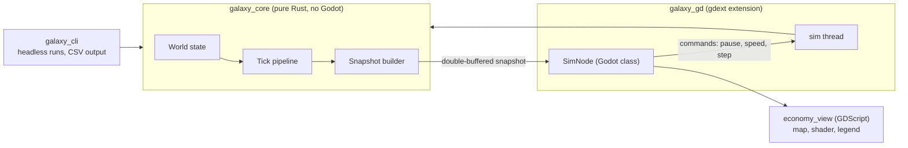

# Rust port: design

Status: **built** (`rust/`): goods crate, economy, colonization, relations, war, diplomacy, personality, threat, alliances, treaties, CLI, and the Godot extension (`GalaxySim`, used by `economy_proto/rust_view.tscn`). Rust is now the source of truth for star and planet generation, including the planet classifier and image-driven placement. Not yet: multi-core parallelism, war-gaming. This document is updated whenever a feature lands in the GDScript prototype
(`economy_proto/`), so the port's shape keeps up with the rules. See the changelog at the end.

## 1. Why, and when

GDScript is the bottleneck. On the 46-system, 4-empire map, one month costs 15 ms at year 10 and ~300 ms by year 180
(438 colonies). Cost grows faster than colony count. 10 empires x 1,000 systems would be several seconds a month.

| Run | Colonies | ms / month |
|---|---|---|
| 46 systems, 4 empires, year 10 | 40 | 16 |
| 46 systems, 4 empires, year 60 | 230 | 77 |
| 46 systems, 4 empires, year 180 | 438 | 300-380 |

Where the time goes (46 systems, 4 empires, 180 years, 413 s total):

| Phase | Share |
|---|---|
| Freight corporations | 56% |
| Extractor corporations (review/expand) | 21% |
| Producer corporations | 15% |
| Markets, emergence, migration, surveys | ~7% |
| Relations, war, diplomacy, personality, threat | < 1% |

**Expected gain:** 20-50x from compiled code, flat data and no dictionary lookups; more from running the read-only
scoring phases on several cores (section 6).

**Gate for starting the port:** the diplomacy roadmap reaches step 5 (multi-party war), so the data model includes
coalitions. Rules changed after the port starts must be written twice, so the port waits until churn slows.

## 2. Goals and non-goals

Goals:
- Same rules and outputs as the GDScript sim, checked by parity tests (section 9).
- Godot stays the front end: map, territory shader, UI.
- A headless CLI that prints the same CSV/EMP/REL/EVENT lines as `run_headless_csv.gd`, so existing plot scripts work.
- Deterministic for a given seed, single- or multi-threaded.

Non-goals for the first version: new mechanics, save/load, networking, mod support.

## 3. Architecture



Cargo workspace:

| Crate | Role | Depends on |
|---|---|---|
| `galaxy_core` | all rules, world state, tick, metrics rows | `rand_pcg`, `rayon` (optional feature), `indexmap` |
| `galaxy_cli` | headless runner; same arguments and output as `run_headless_csv.gd` | `galaxy_core` |
| `galaxy_gd` | Godot 4.7 extension via `godot` (gdext); exposes `SimNode`, owns the sim thread | `galaxy_core`, `godot` |
| `parity` (tests) | runs GDScript and Rust on the same seeds, compares outputs | `galaxy_cli` |

`galaxy_core` never sees Godot types. `Vector2` becomes `glam::DVec2` or a local `[f64; 2]`.

## 4. Data model

Arenas plus typed indices instead of object references. Everything is `f64` like GDScript.

```rust
pub struct ColonyId(u32); pub struct CorpId(u32); pub struct EmpireId(u8); pub struct SystemId(u32);

pub const GOODS: usize = 5;               // Ore, Metal, Parts, Food, Water (goods.gd)
pub type PerGood = [f64; GOODS];          // replaces the Goods.ID -> float dictionaries

pub struct World {
    pub tick: u32,
    pub systems: Vec<StarSystem>,         // system_node.gd
    pub colonies: Vec<Colony>,            // colony_market.gd: settled markets AND frontier bodies
    pub corps: Vec<Corp>,                 // corporation.gd (dead corps removed between ticks; ids never reused)
    pub empires: Vec<Empire>,             // empire.gd
    pub relations: PairMatrix<Relation>,  // upper triangle, N*(N-1)/2 entries (economy_sim._rel)
    pub wars: Vec<War>,                   // military.gd; War { a, b, start, peaks, parent: Option<WarId> }
    pub events: Vec<Event>,
    pub rng: SimRng,                      // section 7
    pub caches: Caches,                   // boards, route geometry, memos (rebuildable, never saved)
}
```

| GDScript | Rust | Notes |
|---|---|---|
| `ColonyMarket` | `Colony` | `stock`, `price`, `use`, `capacity`, `extraction` become `PerGood`; `intel` becomes `[Intel; MAX_EMPIRES]` |
| `ColonyMarket.requests` | `Vec<Request>` cleared each tick | |
| `Corporation` + `Facility` | `Corp { kind: CorpKind, facilities: Vec<Facility>, .. }` | `CorpKind` enum carries kind-specific state (freight fleet, survey jobs) |
| `Empire` | `Empire` | `known: Dictionary` becomes a `BitVec` over systems; `threat` becomes `[f64; MAX_EMPIRES]` |
| `SystemNode` | `StarSystem { owner: Option<EmpireId>, occupier: Option<EmpireId>, bodies: Vec<ColonyId> }` | |
| `economy_sim.relations` (string keys) | `PairMatrix<Relation>` | `stance` becomes an enum |
| `Personality` traits dictionary | `Traits([f64; 7])` + `base: Traits` | trait order fixed (section 10) |
| `events: [[tick, text]]` | `Event { tick, kind: EventKind, a, b, .. }` | text formatted only on output, so the format matches the GDScript lines |

`MAX_EMPIRES = 8`, matching the territory shader's palette.

## 4a. Galaxy placement from images

William's placement design (from the original `universe.gd`):

- **Density map (greyscale image):** each pixel's brightness is the chance a star can sit there. Brighter core and arms
  get more stars; dark lanes and the void get none.
- **Population map (colour image):** at a star's pixel, the R, G and B channels are tried in descending order
  (random order on ties) and the first that passes a roll against its own value picks the population:
  G = Pop I (spiral-arm ridges, youngest), B = Pop I-i (arms), R = Pop II-i, none = Pop II.
- The population then drives metallicity, age, star class and everything downstream in the planet pipeline.

Port notes: the CLI loads the two PNGs with the `image` crate; the extension receives them as Godot `Image` byte buffers.
Sample positions by weighted draw over a cumulative brightness array (exact star count, one pass) rather than one
roll per pixel then a shuffle. The two images must have the same size.

## 5. Module map

| GDScript file | Rust module | Contents |
|---|---|---|
| `goods.gd` | `core::goods` | good ids, base prices, recipes |
| `colony_market.gd` | `core::market` | prices from cover, consumption, births/deaths, maintenance, migration hooks |
| `corporation.gd` | `core::corp::{extractor, producer, freight, surveyor, boards}` | operate, review and expand, construction, freight routing, surveys and claims; opportunity, outpost and survey boards |
| `economy_sim.gd` | `core::world`, `core::colonize`, `core::relations`, `core::metrics` | tick order, taxes, emergence, colonization (outposts, state colonies, sectors), relations and borders, routes and tariffs, CSV rows |
| `galaxy_colonies.gd`, `system_node.gd` | `core::galaxy` | systems and bodies for the economy |
| `galaxy.gd`, `solar_system.gd`, `planet.gd`, `planet_resources.gd`, `astronomy_data.gd` | `core::astro` | the real star and planet generator (population, class, orbits, axes, classification, resources); image-driven placement (section 4a) |
| `military.gd` | `core::military` | target strength, upkeep, fronts, attrition, occupation, peace |
| `diplomacy.gd` | `core::diplomacy::{facts, actions, goals, planner}` | GOAP: facts, actions, goals, planner search, execution |
| `personality.gd` | `core::personality` | traits, weights, drift, event shifts, regime change |
| `threat.gd` | `core::threat` | threat scores, main threat, common threats |
| `treaties.gd` | `core::treaties` | war goals, ultimatums, war score, negotiation, terms, revanchism |
| `alliances.gd` | `core::alliances` | pacts, guarantees, call to arms, effective strength, lapsing |
| (planned) | `core::wargame` | Monte Carlo rollouts of the abstract war model to price war, peace and alliance decisions; runs on beliefs (noisy, personality-biased estimates), own RNG stream per rollout seeded from (tick, empire, candidate), rollouts in parallel with `rayon` |
| `run_headless_csv.gd` | `galaxy_cli` | argument parsing, output |
| `economy_view.gd` | stays GDScript | reads `SimNode.snapshot()` instead of live objects |

## 6. Tick pipeline

The order below is the GDScript `_tick` order and must not change. **R** = reads, **W** = writes.

1. Reset per-month caches and port counters. W: caches, `Colony.port_used`.
2. Corporations, in rotating fair turn order (`_turn_order`). Each corp: operate facilities, review and expand,
   freight, surveys; then pay tax to its empire. R/W: colony stocks, prices, corp cash, empire treasury.
   **Sequential by design:** each corp sees the stocks the previous one left.
3. Migration and sector discoveries, per empire.
4. Multi-empire only: relations, fronts, military (monthly), occupation effects; in month 6 of each year:
   threat, personality drift, GOAP turn per empire.
5. State colonization and survey orders (every `STATE_REVIEW_MONTHS`).
6. Markets tick (prices, births, consumption) and corporation emergence, per colony in order.
7. Remove dead corporations.

### Where parallelism is safe

Corporations must stay sequential in step 2, but most of their cost is **scoring**, which only reads the world:

| Work | Pattern |
|---|---|
| Opportunity / outpost / survey boards (built once per month, per good or per empire) | build boards in parallel at the start of step 2 (read-only), then corps consume them sequentially |
| Freight lane scoring: each freight corp scans source x destination pairs | score candidates in parallel against a frozen view; commit the chosen loads sequentially and re-validate stock at commit. **Parity risk:** the GDScript version re-reads live stock while scoring. Either keep scoring sequential for parity, or accept a rule change ("corps plan on start-of-month prices") and re-baseline. Recommendation: ship v1 sequential and exact, then make the change once as a deliberate rule change. |
| Route geometry (per system pair) | precomputed once per ownership change, parallel |
| Market tick (step 6) | each colony is independent except emergence, so the market updates run in parallel and emergence runs after, in colony order |
| Threat scores, relation borders | parallel per pair |

All parallel steps write to per-item slots and are reduced in fixed index order, so results do not depend on the number
of threads.

## 7. Determinism

- **One RNG stream per subsystem** (`sim`, `personality`, `galaxy`), each a PCG32 seeded from the run seed.
  `Personality` already uses its own stream in GDScript for exactly this reason.
- **Matching Godot's RNG:** Godot's global `randf()` and `RandomNumberGenerator` are PCG32 with Godot's own seeding and
  float conversion. Port that exactly (it is ~40 lines in `core/math/random_pcg.*`) so a Rust run can replay the
  GDScript random sequence. Every `randf`/`randi`/`randfn` call site must be ported in the same order (25 call sites today).
- **Sorting:** Godot's `sort_custom` is unstable; Rust's `sort_by` is stable. Every GDScript sort with possible ties
  needs an explicit tie-break (already done for the payback sorts). **Pre-port task:** audit every `sort_custom` and add
  tie-breaks in GDScript first, re-baseline, then port.
- **Iteration order:** GDScript dictionaries iterate in insertion order. Use `Vec`/`IndexMap`, never `HashMap`, wherever
  order affects results.
- **Floats:** keep `f64`; avoid fused multiply-add and reassociation (no `-ffast-math` equivalents). `ln`, `powf` and
  `exp` may differ from Godot's in the last bit; parity tests compare with a tolerance (section 9).

## 8. Godot boundary (`galaxy_gd`)

- `SimNode` (a Godot `Node`) owns a `galaxy_core::World` on a dedicated thread. The GDScript prototype already does this
  (sim on its own thread, map redrawn between months), so the view's behaviour carries over.
- **Commands in:** a channel of `Pause`, `Resume`, `SetSpeed(f64)`, `Step(n)`, `Configure{..}`.
- **Snapshot out:** after each month the thread fills a `Snapshot` and swaps it into a double buffer. The view reads
  the latest snapshot and never touches live state, so there is no lock on the hot path.

```rust
pub struct Snapshot {
    pub tick: u32,
    pub systems: Vec<SysView>,        // position, owner, occupier, at_front, label, colony/body counts
    pub colonies: Vec<ColonyView>,    // position, pop, shortage, owner
    pub empires: Vec<EmpireView>,     // name, colour, colonies, systems, pop, treasury, strength, traits label, wars
    pub shipments: Vec<Shipment>,     // this month's deliveries, for the ship layer (replaces the shipment_made signal)
    pub wars: Vec<(u8, u8)>,
    pub events: Vec<String>,          // new since the last snapshot
}
```

- Exposed to GDScript as `PackedFloat32Array`s plus small dictionaries for labels, so the view stays thin. The territory
  shader keeps its 1-row float texture input, built straight from `systems`.

## 9. Parity testing

1. `galaxy_cli` prints the same line formats as `run_headless_csv.gd`: `CSV`, `EMP`, `REL`, `EVENT`, `TIME`, `PROFILE`.
2. The parity harness runs both implementations on a fixed matrix of seeds and setups:
   1 empire x 100 systems; 4 empires x 46 systems (the view's map); 4 empires x 200 systems.
3. Compare `CSV`/`EMP`/`REL` columns with a relative tolerance (1e-9 to start); `EVENT` lines must match exactly.
   The first divergent tick and column are reported.
4. Port module by module behind the harness, in this order: goods and markets, extractors and producers, freight,
   colonization and surveys, relations and routes, military, diplomacy, personality, threat.
   Until a module is ported, its outputs can't be compared, so each step is verified on the setups that exercise it.
5. After v1 is exact, deliberate rule changes (for example parallel freight scoring) re-baseline both sides together.

## 10. Feature register

Each feature in the prototype, with what the port must carry. New rows are added as features land.

| Feature | GDScript | State the port must carry |
|---|---|---|
| Markets, prices from cover, births and deaths | `colony_market.gd` | per-good stock/price/use/capacity, pop, max_pop |
| Extractors, producers, construction projects | `corporation.gd` | facilities with build progress, materials owed |
| Freight: ship classes, sailing-time budget, port congestion | `corporation.gd` | fleet size, class, memos (cache only) |
| Colonization: capital, frontier, surveys, claims, outposts, state colonies, sectors | `economy_sim.gd`, `corporation.gd` | per-empire intel per body, known systems, survey jobs |
| Taxes and treasury | `economy_sim.gd` | profit and wealth tax, empire treasury |
| Multi-empire relations, closed borders, treaties, tariffs | `economy_sim.gd` | relation matrix, territory, route geometry cache |
| GOAP diplomacy | `diplomacy.gd` | facts, actions and goals are rebuilt yearly; persistent: refusal cooldowns, arming_until, truces |
| War: strength, fronts, occupation, exhaustion, peace | `military.gd` | strength, exhaustion, wars (start, peaks), occupier per system, truce per pair |
| Army budget: target strength from smoothed income | `military.gd` | `avg_tax`, `target_strength` |
| Personality: 7 traits, drift, regime change | `personality.gd` | `traits`, `base_traits`, `stability`, `regime_year`; trait order: aggression, expansion, mercantile, xenophobia, militarism, caution, intervention |
| Trust and reputation | `alliances.gd` | `Relation.trust` as two directed values; `Empire.reputation` |
| Pacts and guarantees | `alliances.gd` | `Relation.pact`, `pact_year`; `Empire.guarantees` (id -> against, start year); `War.parent` (the war an ally joined) |
| Treaties and revanchism | `treaties.gd` | `War.goals`, `first_strike_until`; per pair: `reparations`, `forced_market`, `forced_transit`, `truce_until`; per empire: `revanche` (victor -> level, claims, since), `demilitarized_until/by` |
| Threat assessment | `threat.gd` | `threat[]` per empire, `main_threat`, `wars_started` (years), `systems_taken`, `sys_history` (yearly) |

## 11. Changelog

- 2026-11-26: planet classifier (`astro::classify`) and image-driven placement (`astro::PlacementMaps`) ported; the CLI
  loads PNGs (`maps=default` or `maps=<dir>`), the extension loads them through Godot's Image (`density_map`,
  `population_map` keys). CI (`.github/workflows/rust.yml`) builds Linux and Windows and uploads `galaxy_gd.dll`.

- 2026-11-25: `galaxy_gd` built (godot-rust 0.5.6, `api-4-7`). `GalaxySim` runs the World on a Rust thread and keeps
  the newest `Snapshot` (plain data, `galaxy_core::snapshot`); `poll()` turns it into a Dictionary of packed arrays
  only when a new month is ready. `World` uses `Arc` instead of `Rc` so it can live on that thread.

- 2026-11-25: Rust-only rule fixes found by 500-year runs (not back-ported to GDScript): trade drift is one small
  nudge a year (not one per partner); incident drift 0.02; a regime change jumps from the old regime's values instead
  of locking in the drifted traits. Together these stopped every empire converging to the same personality.
  Performance: per-phase profiling (`PROFILE` lines), planner restricted to the goal's partner, incremental survey
  board, claim counter, monthly opportunity boards re-checked at pick time, per-empire known-bodies list, incremental
  nearest-colony cache, monthly freight lane lists. 1000 systems x 8 empires x 500 years: 324 s -> 111 s.

- 2026-11-25: **built.** `galaxy_goods` crate added at William's request: every goods table (goods, raw costs, recipes,
  population consumption, maintenance, salvage, subsistence, construction materials, military unit and upkeep goods)
  in one crate, read by the sim. Parity testing against GDScript was dropped by decision; behaviour was checked by
  comparing run shapes. Speed: 46 systems x 4 empires x 180 years in 3.8 s (GDScript ~300-500 s).
  Two GDScript slips were ported as intended rather than as written: the thermal lifespan uses a real cube root
  (GDScript's `1/3` is integer 0), and moon counts check the planet type.

- 2026-11-25: added `core::treaties`. Terms are a tagged enum (`Cede(SystemId) | Reparations | OpenMarket | Transit |
  Demilitarize | Humiliate`), valued by one pure function so negotiation and war-gaming share it.
- 2026-11-25: planned `core::wargame` (after multi-party wars). Keep the war model a pure function of a small
  `WarState` so rollouts can clone it cheaply.
- 2026-11-25: added pacts and guarantees (`core::alliances`). Wars gain a `parent` link: an ally's war joins the
  original one, fights on its front when it has none of its own, and ends with it. Store wars in a slot map so the
  link survives removals.
- 2026-11-25: added image-driven galaxy placement (section 4a) and the astro modules to the module map.
- 2026-11-25: document created. Covers the prototype up to war, personalities, army target strength and threat
  assessment.
